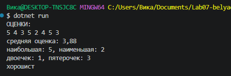
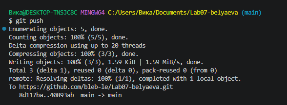

# Практическая работа №7. Массивы и foreach

**ФИО:** беляева виктрия дмитриевна
**Группа:** ИСП-241
**Дата:** 25.11.2026

## Что изучено

- массив хранит много значений одного типа под одним именем, и это удобно! индексы начинаются с нуля.
- `foreach` удобен, когда нужно только прочитать все значения по очереди, а если надо изменить элементы массива, или нужен индекс, или перебирать надо в обратном порядке, то нужен обычный `for`!!
- научилась решать задачи с массивами: считать сумму и среднее, искать минимум и максимум, считать, скольк элементов подходит под условие, и разворачивать массив, меняя элементы местами через временную переменную....

## Скриншоты

